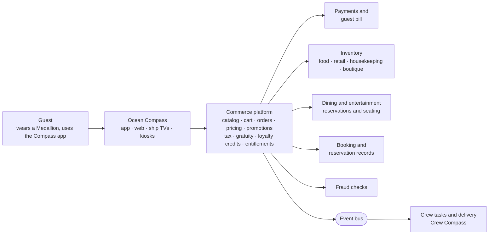

# Ocean Medallion: The Shopping, Dining & Concierge Engine

> How a cruise line replaced queues, paper and separate systems with one wearable and one app, and the commerce platform behind it.

**Case study by Debashish Patra** · Product Owner · Accenture × Carnival Corporation · 2016–2017

---

## The 30-second version

Carnival wanted every guest on a cruise ship to buy, book and order anything with a tap, without cards, cash or queues. I was the **Product Owner for three of the guest-facing products**: **Ocean Concierge** (what to do), **Shop Ocean** (what to buy) and **Dine Ocean** (what to eat). Behind them sat a **full e-commerce platform** connecting more than 20 ship and shore systems. The programme launched on Princess Cruises' *Regal Princess* in November 2017.

## Before → After

| | Before | After |
|---|---|---|
| **Paying** | Cards and cash, a separate bill per venue | One wearable, one guest bill |
| **Ordering food** | Wait for a server, repeat your preferences | Order from your phone, TV or kiosk; it finds you |
| **Booking shows and dining** | Queue at a desk or call | Book and get a seat in the app |
| **Buying excursions, spa, merchandise** | Different counters, different systems | One catalog, one cart |
| **The systems underneath** | Each brand ran its own | One shared platform across brands |

## The three products I owned

| Product | A guest can… | Think of it as |
|---|---|---|
| **Ocean Concierge** | Discover things to do, reserve dining and shows, get a seat | A personal assistant in your pocket |
| **Shop Ocean** | Browse and buy merchandise, photos, spa services and shore excursions | An online store that works at sea |
| **Dine Ocean** | See a digital menu, order food and drinks, set dietary preferences | Food delivery that knows where you are on the ship |

## How it fits together

A step-by-step walk-through of one drink order is in [docs/how-it-works.md](docs/how-it-works.md).

## What I did

- **Product ownership and roadmap.** Defined and prioritised the backlog for the three products: **90+ features across 14 capabilities**. Sequenced delivery across three milestones leading to the November 2017 launch.
- **Commerce architecture and integration.** Drove an e-commerce build on **Elastic Path**, with a thin microservice layer and an event bus. It was multilingual, multi-currency and multi-device. Integrated **20+ systems**, including payments, reservations, inventory (**CrunchTime**) and seating. This replaced siloed brand-level systems with one cross-brand platform.
- **Agile delivery and governance.** Ran **two-week sprints**, prioritisation and backlog governance across Accenture, Carnival and partner teams. Kept stakeholders from CXO to GM level aligned using a requirements document traced back to business goals.

More detail on scope and boundaries: [docs/my-role.md](docs/my-role.md).

## Timeline

| When | Milestone |
|---|---|
| Oct–Nov 2016 | Business requirements and logical architecture agreed |
| Feb 2017 | **Pre-Cruise:** account, journey planning, check-in |
| May 2017 | **On-Board:** Shop Ocean, Dine Ocean, notifications, wayfinding |
| Aug 2017 | **Launch preparation:** testing, performance tuning, content checks |
| Nov 2017 | Launch aboard *Regal Princess*, then a phased rollout across the Princess fleet |

## By the numbers

**My workstream**

- 3 product lines · 90+ features · 14 capabilities
- 20+ integrated systems
- 2-week sprints

**The wider programme** (public figures, not attributed to my workstream)

- A guest base of 10 million+ across Carnival Corporation
- A network of thousands of sensors aboard each ship
- OceanReady, a different product, cut check-in time from about 10 minutes to about 30 seconds

## Repo map

| File | What's in it |
|---|---|
| [docs/how-it-works.md](docs/how-it-works.md) | One order, step by step, and design choices |
| [docs/my-role.md](docs/my-role.md) | What a Product Owner did here, and what I did *not* own |
| [docs/glossary.md](docs/glossary.md) | Plain-English definitions of every term used |

---

*A personal portfolio summary written from my own work. It contains no confidential client documents; descriptions are simplified, and internal system names are deliberately generalised. Carnival, Princess Cruises, Ocean Medallion, Elastic Path and CrunchTime belong to their respective owners.*
