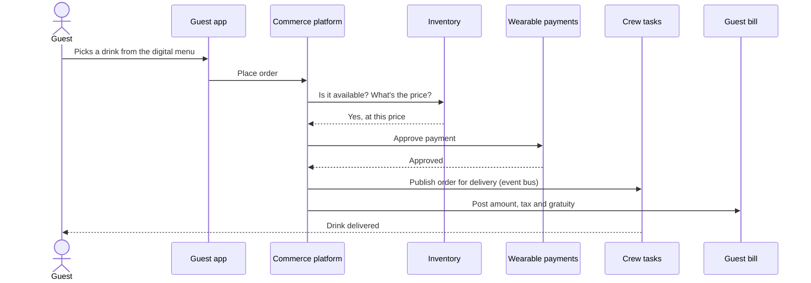

# How it works: one drink order, step by step

A guest on the pool deck wants a drink. Here is what happens behind the screen.

| Step | Plain English |
|---|---|
| Menu | The guest sees a live menu, tailored to their dietary preferences |
| Availability and price | The platform checks stock and price with the inventory system |
| Payment | The wearable identifies the guest; the payment system says approved or not |
| Delivery | The order is announced to the crew's task system, so the right person delivers it |
| Bill | The amount, tax and gratuity land on the guest's single bill |

## Design choices behind the platform

| Choice | Why it matters |
|---|---|
| **Buy the commerce engine, build the glue** | A proven e-commerce product (Elastic Path) handles catalog, cart and pricing. A thin custom layer adapts it to ship life. |
| **One platform for every brand** | Replaces duplicate systems (ordering, inventory, seating, payments) each brand ran on its own. |
| **Event-driven** | Systems announce "an order was placed" instead of calling each other directly, so one slow system doesn't stall the rest. |
| **Multilingual, multi-currency, multi-device** | Guests come from many countries and use phones, ship TVs and kiosks. |
| **Ship and shore stay in sync** | Ships sail with limited connectivity, so data must reconcile when the ship reconnects. |

## Where each product fits

- **Concierge** reads from the experience catalog and the reservation and seating system.
- **Shop** sits on the product catalog, cart and order management.
- **Dine** adds menus, recipes, kitchen ordering and food inventory.

All three share the same commerce core, so a guest gets one cart, one bill and one identity.
